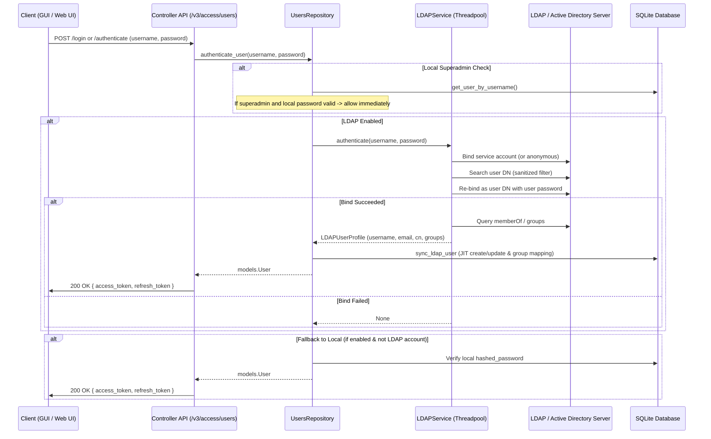

# Native LDAP and Active Directory Authentication

## Overview

GNS3 v3 supports centralized directory authentication via Lightweight Directory Access Protocol (LDAP) and Microsoft Active Directory (AD). This enables organizations to authenticate users against central identity stores, automatically provision user accounts into GNS3 via Just-In-Time (JIT) provisioning, and map corporate directory groups to GNS3 Role-Based Access Control (RBAC) groups.

### Key Capabilities
- **Decoupled Architecture:** Client applications (`gns3-gui`, `gns3-web-ui`, CLI) require zero protocol changes; credential verification and token minting occur on the server.
- **Just-In-Time (JIT) Provisioning:** Users are automatically created in GNS3 upon their first successful directory login.
- **Group-to-RBAC Mapping:** Directory security groups (`memberOf` or group queries) map dynamically to GNS3 `UserGroup`s (`Administrators`, `Users`, custom groups).
- **Transport Security:** Full support for LDAPS (`ldaps://`, port 636) and StartTLS (port 389) with certificate verification and custom CA bundles.
- **Emergency Superadmin Fallback:** The local `admin` superadmin account is always evaluated first against the local database, guaranteeing administrative recovery during directory outages.
- **Diagnostic Testing:** Native test connection endpoint (`POST /v3/settings/ldap/test`) to validate connectivity, bind credentials, and search queries before saving.

---

## Architecture



---

## Configuration Reference

LDAP settings are configured in `gns3_server.conf` under the `[LDAP]` section or managed via `PUT /v3/settings`.

| Setting | Type | Default | Description |
| :--- | :--- | :--- | :--- |
| `enabled` | `bool` | `False` | Enable LDAP/Active Directory authentication. |
| `uri` | `str` | `ldap://localhost:389` | LDAP URI (`ldap://host:port` or `ldaps://host:port`). |
| `bind_dn` | `str` | `None` | Service account DN for directory searches (optional for anonymous). |
| `bind_password` | `secret` | `None` | Password for `bind_dn`. Masked as `**********` in API responses. |
| `base_dn` | `str` | `""` | Search base DN for locating user objects. |
| `user_search_filter` | `str` | `(&(objectClass=person)(|(uid={username})(sAMAccountName={username})))` | Filter template to find users. `{username}` is safely escaped. |
| `user_attr_username` | `str` | `uid` | Attribute containing the canonical login name (`sAMAccountName` in AD). |
| `user_attr_email` | `str` | `mail` | Attribute containing user email address. |
| `user_attr_fullname` | `str` | `cn` | Attribute containing user full display name (`displayName` or `cn`). |
| `group_search_base` | `str` | `None` | Base DN for group queries (defaults to `base_dn` if empty). |
| `group_search_filter` | `str` | `(&(objectClass=groupOfNames)(member={user_dn}))` | Filter template for directory group searches. |
| `group_mapping` | `dict` | `{}` | JSON map of LDAP group CN/DN to GNS3 `UserGroup` name. |
| `default_group` | `str` | `Users` | Default GNS3 `UserGroup` assigned if no mapped groups match. |
| `start_tls` | `bool` | `False` | Upgrade cleartext connection using StartTLS before binding. |
| `verify_cert` | `bool` | `True` | Verify TLS certificates for LDAPS / StartTLS. |
| `ca_cert_file` | `str` | `None` | Path to custom CA certificate bundle file. |
| `fallback_to_local` | `bool` | `True` | Allow local database accounts to log in if LDAP check fails. |
| `timeout` | `int` | `10` | Socket connect/read timeout in seconds (1 to 120). |

---

## Configuration Examples

### Active Directory (LDAPS)

```ini
[LDAP]
enabled = True
uri = ldaps://dc1.example.com:636
bind_dn = CN=gns3-svc,OU=ServiceAccounts,DC=example,DC=com
bind_password = ServiceAccountSecretPassword
base_dn = OU=Employees,DC=example,DC=com
user_search_filter = (&(objectClass=user)(sAMAccountName={username}))
user_attr_username = sAMAccountName
user_attr_email = mail
user_attr_fullname = displayName
group_mapping = {"GNS3-Admins": "Administrators", "Network-Engineers": "Users"}
default_group = Users
verify_cert = True
ca_cert_file = /etc/ssl/certs/corporate-root-ca.pem
fallback_to_local = True
timeout = 10
```

### OpenLDAP / FreeIPA (StartTLS)

```ini
[LDAP]
enabled = True
uri = ldap://ldap.example.com:389
start_tls = True
bind_dn = cn=admin,dc=example,dc=com
bind_password = AdminSecretPassword
base_dn = ou=people,dc=example,dc=com
user_search_filter = (&(objectClass=inetOrgPerson)(uid={username}))
user_attr_username = uid
user_attr_email = mail
user_attr_fullname = cn
group_search_base = ou=groups,dc=example,dc=com
group_search_filter = (&(objectClass=groupOfNames)(member={user_dn}))
group_mapping = {"cn=netops,ou=groups,dc=example,dc=com": "Administrators"}
default_group = Users
fallback_to_local = True
```

---

## Diagnostics & Connection Testing

Administrators with `Server.Modify` privileges can test LDAP settings and canary queries via the REST API or Web UI:

### Endpoint: `POST /v3/settings/ldap/test`

```bash
curl -X POST http://localhost:3080/v3/settings/ldap/test \
  -H "Authorization: Bearer <ADMIN_TOKEN>" \
  -H "Content-Type: application/json" \
  -d '{
    "enabled": true,
    "uri": "ldaps://dc1.example.com:636",
    "bind_dn": "CN=gns3-svc,OU=ServiceAccounts,DC=example,DC=com",
    "bind_password": "ServiceAccountSecretPassword",
    "base_dn": "OU=Employees,DC=example,DC=com"
  }'
```

### Response
```json
{
  "status": "success",
  "bind_successful": true,
  "user_search_successful": true,
  "users_found": 5,
  "latency_ms": 34.2,
  "message": "Successfully connected to LDAP server in 34.2ms. Found 5 sample user(s) in base DN."
}
```

---

## Security & Architectural Guarantees

1. **Injection Neutralization (CWE-90):** All query variables are sanitized using `ldap3.utils.conv.escape_filter_chars` to neutralize LDAP filter breakout attacks.
2. **Anonymous Bind Defense (CWE-287):** Empty or whitespace-only password attempts are rejected before contacting the LDAP server.
3. **Passwordless Login Defense (CWE-287):** Directory accounts (`auth_source == "ldap"`) cannot use local database recovery fallbacks.
4. **Transport Encryption Ordering (CWE-319):** StartTLS negotiation executes prior to transmitting bind credentials over the network.
5. **Credential Immutability (CWE-284):** Password update endpoints (`PUT /v3/access/users/{id}` and `PUT /v3/access/users/me`) reject password change attempts on directory users with `HTTP 400 Bad Request`.
6. **Non-Blocking Concurrency:** All network I/O executes in background threads (`asyncio.to_thread`), preventing denial of service on FastAPI's async event loop.
